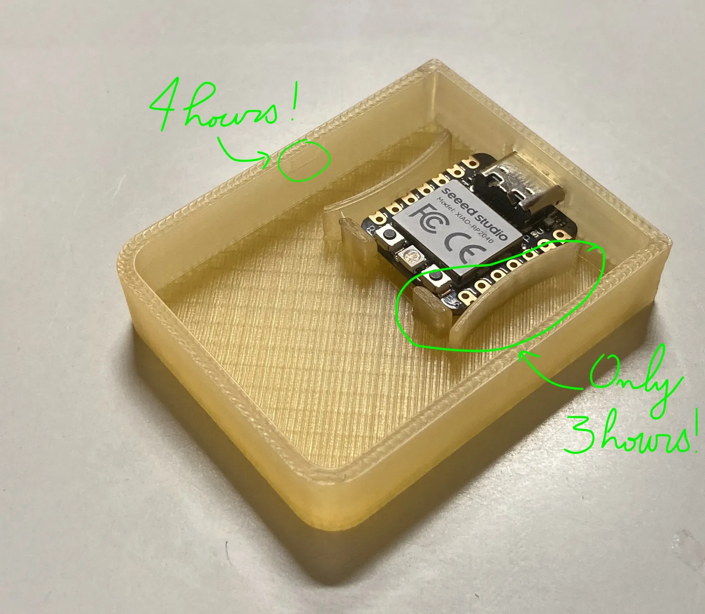

Hey Ruby friends,

Welcome to the 14th episode of the Ruby Stained Glass Notes. Sorry for missing the sending window last Sunday: a mix of a flu vaccine and family business made it impossible for me to send the email.

If you're new here, thank you for signing up to this pop-up newsletter about a crazy project of mine: [a limited-edition stained-glass panel celebrating Ruby](/projects/ruby-stained-glass/).



## Estimated date of the pre-sale

I wanted to send a quick update today, outside my usual sending schedule, because my plan is to open the pre-sale next week-ish. That should give me enough time to make your panels and post them early enough for you to receive them before Christmas (fingers crossed).

I'm currently setting up Stripe payment links. They'll let me publish a page where you can buy the panel on its own and add the wooden stand as an extra. That should make all the calculations around stock, shipping, taxes and so on much easier!

An aside: the Stripe account is owned by the cooperative I'm a member of. In case you didn't know, I have an unusual setup as a freelancer. I haven't set up a company of my own. Instead, I've joined a cooperative that acts as an administrative and fiscal umbrella for entrepreneurs. They help with admin work, dealing with the French tax authorities and all that jazz. We also have coaches who help us talk things through and think about development plans, finding new business, and so on. Even better, they encourage us to be active in the life of the cooperative, so we learn how things work, like how our salaries and taxes are calculated. And we get to meet people from all walks of life!

## 3D modelling is HARD

Let's ~~moan~~ talk about 3D modelling, shall we?

I've spent almost all my Monday afternoons in October and November at my local makerspace, trying to model the small box that will house the microcontroller. It's been humbling, to say the least: Fusion 360 has an extremely steep learning curve.

To give you an example, last Monday I spent four hours designing two teeny-tiny bumps and their matching holes, so the lid has a better friction fit with the box. You can't even see these components unless you zoom right in, yet they took me ages (and they work pretty well)!

<figure>
  
</figure>

Working in Fusion 360 can be quite infuriating, because there are so many things you'd like to do but can't figure out how. It's not that the software isn't capable of them, it's just that the interface makes it very hard to find where to do what.

At first, this annoyed me a lot. But I quickly realised that many of the things I was trying to do made no sense in terms of actual modelling in three dimensions. There are constraints and rules you need to follow. So now, whenever I'm stuck, I try to see it through the lens of real-world modelling. Does moving that component to the left make it hit a wall? What do I need to build a mirror image of this arc?

Adding features to this kind of software must be very (very!) challenging. The number of constraints one needs to accommodate must be staggering.

## I built a dedicated page for the project

So far, I've relied on the initial blog post to share the project, but I've finally taken the time to slap together a proper landing page. I'll add more information later on, but I'm already really happy with the hero video.

<figure>
  <video autoplay loop muted playsinline poster="/assets/media/2026/11/ruby-stained-glass-panel-hero-2-poster.webp" aria-label="the hero video of the Ruby Stained Glass project page">
    <source src="/assets/media/2026/11/ruby-stained-glass-panel-hero-2.webm" type="video/webm">
    <source src="/assets/media/2026/11/ruby-stained-glass-panel-hero-2.mp4" type="video/mp4">
  </video>
</figure>

This page is part of a larger redesign of my website: notebook vibes, 8-bit details and pops of colour to dazzle your eyes! [Check out the project page here](/projects/ruby-stained-glass/).

That's it for this week! Talk to you next Sunday, hopefully with an actual launch date for the pre-sale!


