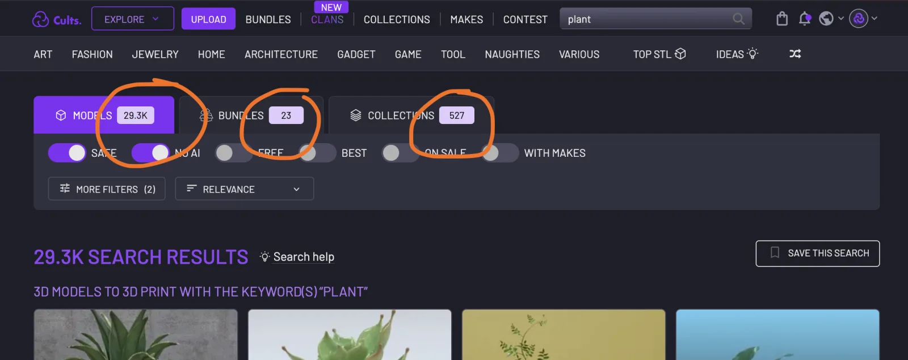

### The problem

I'm currently working on adding different types of records to the [Cults](https://cults3d.com/) search page. Instead of being able to query creations only, users can now search for creations, bundles and public collections (with more types of records to come).

Right now, the search page has three tabs: **creations**, **bundles** and **public collections**. Each tab has a small counter component which displays how many results it has, so users can see if their query matched before navigating to one of these tabs.



To show these counters to the users, the page needs to query a bunch of stuff **before its first paint**:
  - the collection of records of the current tab (the count is free here)
  - the count of records for each of the inactive tabs

On the creations tab, we run two extra queries on top of the main search. With 4 million designs in production, these extra counts add up, especially when users are waiting for the creations to show up on the page.

We're working on making these queries faster, but our search partially runs on a hosted open source database: each query also pays for a network round trip, which adds a lot of variability to the mix.

Here's what happens today:

```txt
# For a query "game"

Browser                                      Server                                                  Database
   │                                            │                                                        │
   │  GET /search?q=game                        │                                                        │
   │───────────────────────────────────────────▶│                                                        │
   │                                            │  Search creations matching query (count is free here)  │
   │                                            │───────────────────────────────────────────────────────▶│
   │                                            │◀───────────────────────────────────────────────────────│
   │                                            │  Count bundles matching query                          │
   │                                            │───────────────────────────────────────────────────────▶│
   │                                            │◀───────────────────────────────────────────────────────│
   │                                            │  Count public collections matching query               │
   │                                            │───────────────────────────────────────────────────────▶│
   │                                            │◀───────────────────────────────────────────────────────│
   │  HTML (all three counts)                   │                                                        │
   │◀───────────────────────────────────────────│                                                        │
   │                                            │                                                        │
✅ first paint
```

### Defer the counts

Users need the results of their active tab right now. The other tabs' counters can wait for a bit.

So I decoupled the counters from the rest of the page:

1. The page renders the active tab with its results and counter. The query made for the active tab already computes this count, so it's free.
2. Each inactive tab now shows a blank placeholder counter. Once the page is painted, each placeholder fetches its own count from a dedicated endpoint and swaps the number in.

Now, counts are deferred and load asynchronously after the first paint, and the requests for each inactive tab run concurrently.

```txt
# For a query "game"

Browser                                      Server                                                  Database
   │                                            │                                                        │
   │  GET /search?q=game                        │                                                        │
   │───────────────────────────────────────────▶│                                                        │
   │                                            │  Search creations matching query (count is free here)  │
   │                                            │───────────────────────────────────────────────────────▶│
   │                                            │◀───────────────────────────────────────────────────────│
   │  HTML (placeholder counters)               │                                                        │
   │◀───────────────────────────────────────────│                                                        │
   │                                            │                                                        │
✅ first paint                                  │                                                        │
   │                                            │                                                        │
   │  GET /search/count?q=game&tab=bundles      │                                                        │
   │───────────────────────────────────────────▶│                                                        │
   │  GET /search/count?q=game&tab=collections  │                                                        │
   │───────────────────────────────────────────▶│                                                        │
   │                                            │  Count bundles matching query                          │
   │                                            │───────────────────────────────────────────────────────▶│
   │                                            │  Count collections matching query                      │
   │                                            │───────────────────────────────────────────────────────▶│
   │                                            │◀───────────────────────────────────────────────────────│
   │                                            │◀───────────────────────────────────────────────────────│
   │  Bundles count swapped in with Turbo       │                                                        │
   │◀───────────────────────────────────────────│                                                        │
   │  Collections count swapped in with Turbo   │                                                        │
   │◀───────────────────────────────────────────│                                                        │
   │                                            │                                                        │
```

### How I built it

- **A small PORO to fetch the count:** I pulled the counting logic out of the tabs ViewComponent into a plain Ruby object. Given a tab and the search filters, it picks the right search and returns a number.
- **A dedicated count endpoint:** Returns one small Turbo Frame holding the formatted number.
- **Turbo Frames in the tabs:** Each inactive tab renders a `<turbo-frame>` with a `src` pointing to that endpoint. Turbo fetches each one as soon as the page loads and swaps the number in. I didn't use `loading="lazy"`: the tabs are always visible, so waiting for them to scroll into view would change nothing.
- **One component for the counter:** Whether it shows a number or is in its loading state, the counter comes from the same small component. That keeps the page and the endpoint from drifting apart.

### Some details to enhance the UX

The empty placeholder needs to have the same width and height as the final counter. The `ch` and `lh` CSS units made that easy.

A small touch: while it loads, the placeholder pulses between the counter's background color and a lighter shade.

### The result

The search page sends its HTML as soon as the main search is done. The other tabs' counts arrive a moment later, each in its own request.

According to our profiler, this shaved a good 1.5 seconds off the first paint.

The server does about the same total work, but the user no longer waits for less important requests before being able to browse results.
