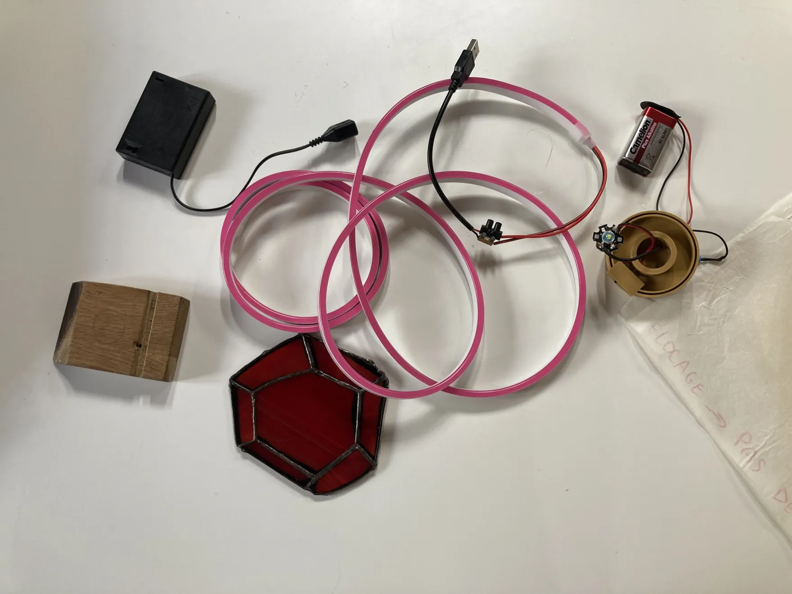
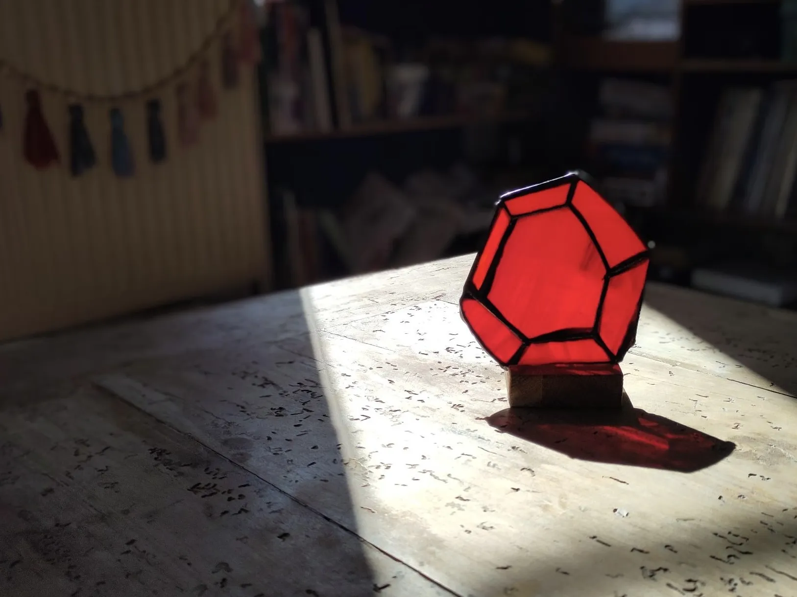

Hey Ruby friends,

This is the 11th episode of the Ruby Stained Glass Notes. Thank you to all of you who reached out after [the last episode](/ruby-stained-glass-notes-10/). A lot of you inquired about the price. We'll talk about that later in this episode.

If you're new here, thank you for signing up for this pop-up newsletter about this crazy project of mine: [a limited-edition stained-glass panel celebrating Ruby](/ruby-stained-glass/).



Let's go!

## Down the electronics 101 rabbit hole

After deciding to explore the possibility of putting a light in the wood stand, I was left with more questions: Which parts do I need? How do I build this contraption? How am I ever going to fit it into a piece of wood?

So I spent last Monday afternoon at my local makerspace. On Mondays, they open up the whole space. For a small fee, you can spend the day there, ask the staff questions and use the machines. It's ideal for prototyping things quickly.

After some back and forth with the staff, we decided that the easiest route for me was to get a microcontroller with some of the components already built in. If you're curious, we chose the Seeed XIAO RP2040. It has everything I need (and more!): a USB-C port, a processor, some RAM and flash memory, and a 3.3V RGB LED. It's probably overkill for what I want to do, but if it makes building easier, I'll take it.

<figure>
  
</figure>

The microcontroller lets me either keep it super simple (the light turns on when plugged in) or add light sequences. I haven't made up my mind yet. But I also know that if some of you want to hack it and go fancy with the light, you'll be able to.

## Then down the 3D printing rabbit hole

One open question is how to fit the light into the stand. I'd like to keep the machining as simple as possible. I have no ambition to turn this into a core part of my business, so let's not go all Six Sigma on it (yes, I'm hoping that writing it down will make my brain behave).

I'm thinking I could make something quite pretty by routing out a simple rectangle and inserting a 3D-printed box into it. With a translucent filament, the box would diffuse the LED's light and light up the panel more evenly than a bare LED would. And I'm pretty sure I'll be able to design something a bit more elevated than a plain rectangular box. The 3D-printed box would also help me keep the board firmly in place.

<figure>
  <video src="/assets/media/2026/10/ruby-stained-glass-notes-11-03.mp4" width="800" height="356" autoplay loop muted playsinline aria-label="a 3D model of the wood stand with a rectangular cavity and a box that fits into it"></video>
</figure>

## What about the price?

The question of the price keeps popping up through various channels.

This week, I talked about it with Coline, my co-op's coach. We agreed that pricing this project had so little to do with how you'd price a "normal" stained-glass panel that I shouldn't overthink it. As long as I have a rough idea of what the materials cost and how much time it'll take to build one, I can come up with a number.

I haven't settled on anything definite yet. There are still missing pieces I need to figure out before I can give you a ballpark estimate.

<figure>
  
</figure>

But fear not! I'm on it: next Monday, I should get the cost for 3D printing each box, and on Tuesday, a quote from my woodworker friend for machining the stand.

That's it for this week, thank you for reading!


