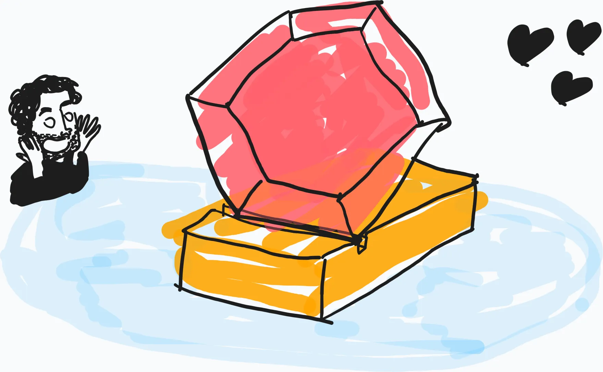
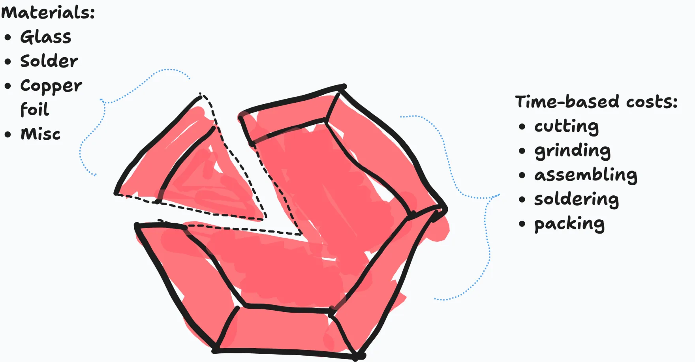
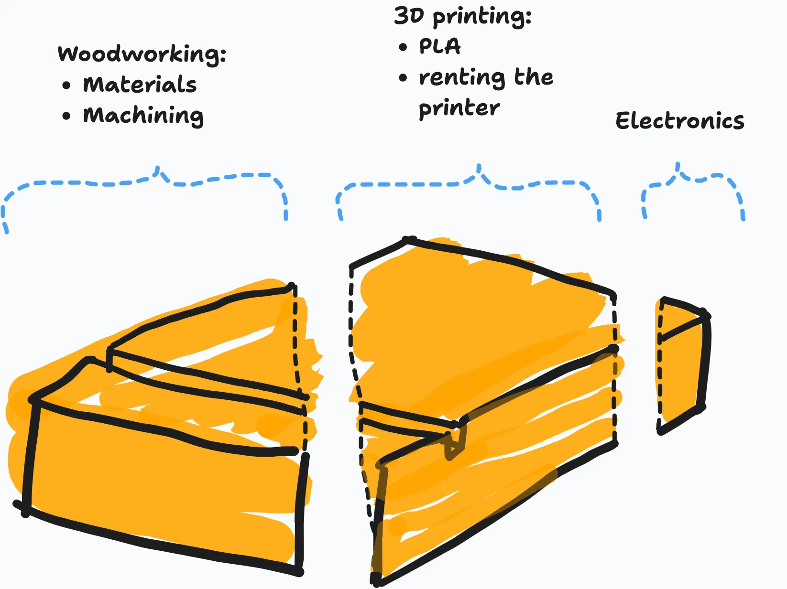

Hey Ruby friends,

Welcome to the 12th episode of the Ruby Stained Glass Notes. Today is the day we've all been waiting for: let's talk about the price! Spoiler: it's €300.

If you're new here, thank you for signing up to this pop-up newsletter about this crazy project of mine: [a limited-edition stained-glass panel celebrating Ruby](/ruby-stained-glass/).



Allons-y, Alonso!

## How much will it cost?

Most of the time, a price is a black box. A merchant gives you a number but never what's behind it. I wanted to try something more transparent and explain what went into it.

I've been putting off deciding on a price for too long. I was mostly scared that:

- setting the price too low would make this project financially unviable
- setting the price too high would make people lose interest

But this week I listed everything that goes into making the Ruby stained-glass: the glass, the wood, 3D printing, microcontrollers, time, shipping...

After adding things up, I've decided on the following prices:

- for the stained-glass and the wooden stand: €300
- for the stained-glass alone: €250
- for the stand alone: please don't buy just the stand! 😅

All these prices exclude shipping (I talk about shipping below).

I'll make sure you can buy either the stained-glass alone or as a bundle with the wooden stand.

Rather than just giving you a price, I've done some scribbles to explain how I came up with it.

<figure>
  
</figure>

## The price breakdown (for each panel)

Let's start with the pricing of the stained-glass.

<figure>
  
</figure>

First, I accounted for all the materials and their shipping costs:

- glass: €15
- other materials (solder, patina...): €5
- shipping: €5

Then there's my time building the stained-glass. Cutting, grinding, assembling, soldering, cleaning and packing will take me around 3 hours per panel. This translates to around €225.

Materials I price at cost, but my time I price so that it's financially viable for me.

Now, the wooden stand.

<figure>
  
</figure>

For the wooden stand, there are more moving pieces. Sourcing and machining the wood, I'll leave to my woodworker friend Oceane.

She gave me a rough estimate of €25 per stand for her work.

Then there's 3D printing the box that holds the microcontroller, the LEDs and so on. Between the PLA and renting the 3D printer at my local makerspace, that's around €20 each.

Each microcontroller, including shipping, costs around €5 as well. So all in all, the wooden stand comes to around €50. This leaves me a bit of wiggle room if I have to adjust things slightly and costs go up a bit.

## Shipping

Shipping costs around €15 within Europe and around €35 to the rest of the world.

I'm using La Poste, the French postal service, to send the packages. For a small operation like mine, they have the most reasonable pricing. Packaging doesn't amount to much, tbh. A plain cardboard box is less than €1, and I've collected plenty of filling material to secure the package (recycling for the win!).

Some countries charge additional duties and tariffs. I know some of you are in the US. I ran a simulation with La Poste, and the tariff for the stained glass should be around €35, which will have to be paid at checkout.

To make sure there are no hiccups, I'll probably use Shopify or something similar. I know their built-in solution handles these situations.

## What's next?

Over the next two weeks, I'll finish prototyping and set up the online shop. If all goes to plan, sales should open in the first half of November. I'll let you know as soon as it's live, so keep an eye on your inbox!

See you next week,



PS: Oh, and speaking of swaying politics… I'm thinking about giving a percentage of the profits to one (or several) French charities that support trans kids. I haven't worked out the details yet, but our transgender siblings are facing a real political backlash everywhere right now, so I'd love to give them whatever help I can.
