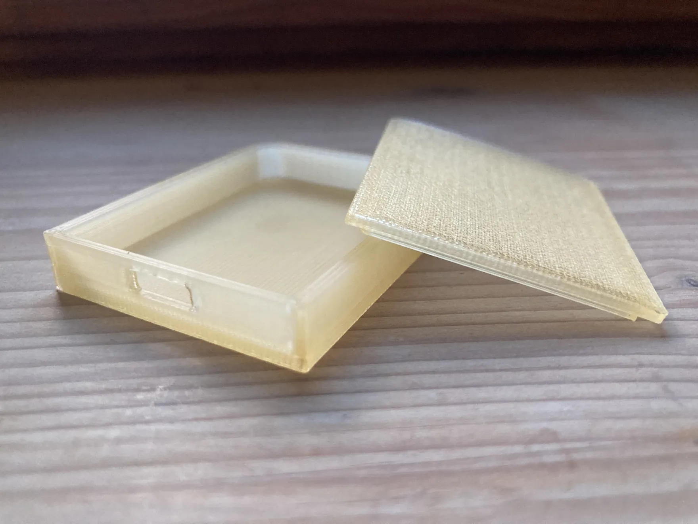

Hey Ruby friends,

Welcome to the 13th episode of the Ruby Stained Glass Notes. Thank you all for your kind words after [my last email](/ruby-stained-glass-notes-12/). I'm glad I didn't miss the mark on the price. That's a relief! Today, we'll talk about the feeling you get when something you've been working on finally comes together.

If you're new here, thank you for signing up to this pop-up newsletter about this crazy project of mine: [a limited-edition stained-glass panel celebrating Ruby](/ruby-stained-glass/).



Let's go!

## 3D printing the light box

I spent last Monday afternoon at the makerspace modelling and 3D printing the translucent box that'll house the microcontroller and the light.

I did a 3D modelling course last year, but I'm guilty of not having opened Fusion since. So getting back to it was quite the challenge. The learning curve isn't made any easier by the complexity of the application itself. But since Fusion is used by actual professionals (not dilettantes like me), I get why it's tough to understand at first glance.

Luckily, the fablab staff helped me get my bearings and work on a first prototype. The afternoon was spent wrangling with sketches, construction lines, extrusions and the like. My efforts weren't in vain, as I was able to model a basic shape for the box.

<figure>
  <video src="/assets/media/2026/10/ruby-stained-glass-notes-13-01.mp4" width="1504" height="820" autoplay loop muted playsinline aria-label="modelling the light box in Fusion"></video>
</figure>

After a quick pass in the slicer, the staff sent it to the printer for an overnight print.

The next day, I was able to come and pick up my 3D-printed design \0/.

<figure>
  
</figure>

## Putting things together for the first time

There's a very special feeling when you get to see a project coming together for the first time.

For a long time, you've thought about it, talked about it, written about it... And yet, things are still waiting in some kind of limbo. Then one day, you get to put the pieces together, and there is that thing you've worked on for so long, in all its glory.

I had that same feeling recently with [Cults](https://cults3d.com/en), one of my clients on my retainer offer. I've been working with the team on allowing designers to sell bundles of their 3D designs. Seeing the feature released to the designers last June, and how the community took hold of it, was *really* cool.

<figure>
  <video src="/assets/media/2026/10/ruby-stained-glass-notes-13-03.mp4" width="640" height="360" autoplay loop muted playsinline aria-label="the stained-glass ruby lit up from its wooden stand, next to a laptop showing code"></video>
</figure>

Anyway, on Tuesday, I went to the fablab and picked up my 3D-printed box. Back home, I opened the parcel with the microcontrollers I'd received a couple of weeks earlier. With a bit of LLM help, I slapped together a quick and dirty Python script to light the LED up in white. I uploaded my `.py` file to the microcontroller, popped it into the box, plugged it into my computer and put the stained-glass on the stand.

<!-- TODO: image -->

Let me tell you, even if it's a very crude V1, it's heartwarming to see this quirky project come to life.

Then, of course, it was evening, so the kids asked me to stop gaping at the stained-glass and make them something to eat.

## I'll need to make some adjustments

I immediately noticed a few things that could be better.

First off, I'll need to add some "walls" inside the box to keep the microcontroller from rattling around. The lid of the box also needs a better friction fit.

I'm not sure about the microcontroller's built-in LED either. It works pretty well in a dim environment, but as soon as there's a bit of sun coming through the window, the light gets washed out. I'll order some LED strips and run some tests.

That's it for this week! There won't be an episode next week, but I'll be back in early November with a better 3D-printed box, a brighter light and, hopefully, a proper prototype.


