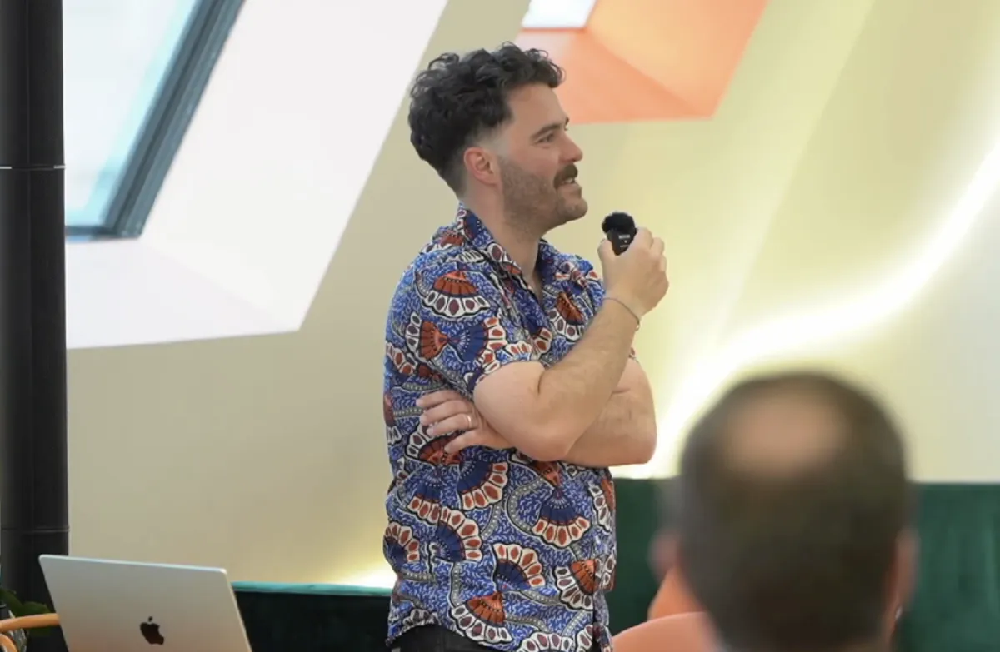
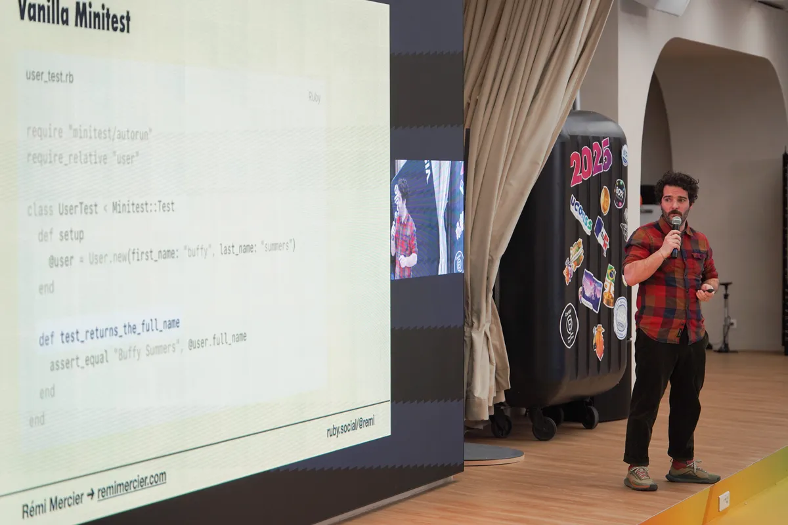
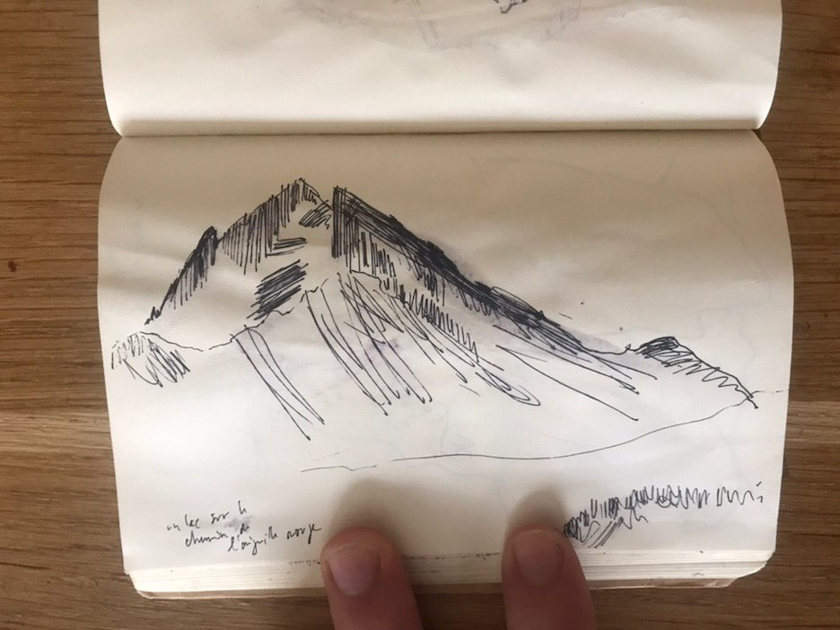

# Hullo there! I'm Rémi Mercier.

I'm a **[freelance software engineer](/work/)**, a **[writer](/blog/)**, and a former **[stained-glass maker](/ruby-stained-glass)** (yep).

<figure>
  
  <figcaption>Presenting a talk about <a href="https://www.rubyevents.org/talks/recherche-en-plein-texte-avec-postgresql">full-text search at the Paris.rb Meetup in 2025</a></figcaption>
</figure>

## Main occupation: software engineer

I've been a **professional developer for the past eight years**, and I've worked in tech for twelve years. Before being a professional programmer, **I worked in product and marketing for startups** for four years. Before that, I held an awful lot of jobs, mostly in non-tech (albeit very nerdy) fields for 15 years.

**I define myself as a product engineer: <mark>someone who's good at the intersection of tech, business and humans</mark>**.

Are you a small to mid-sized team? Are you struggling to get your roadmap done? Head over to [the page dedicated to my retainer offer](/work/). I'm currently working with small to mid-sized teams to help them ship Rails applications that generate 6-figure revenues.

<figure>
  
  <figcaption>Giving my <a href="{{ '/topics/minitest/' | relative_url }}">introduction to Minitest</a> talk at ParisRB (early 2026)</figcaption>
</figure>

Right now, I'm actively working on [the Ruby Stained Glass project](/ruby-stained-glass/) where I build limited-edition stained-glass panels celebrating our beloved language, Ruby.

## Writing

I run this website where I share what I learned while building software. It's my way of giving back to the community.

I focus on making things as simple to understand as possible: real-life examples, step-by-step tutorials, expressive naming, etc... No `def foo =  @bar` shenanigans.

I mostly write about [Ruby](/topics/ruby/) and [Rails](/topics/rails/), [testing](/topics/testing/) (with both [RSpec](/topics/rspec/) and [Minitest](/topics/minitest/)), [debugging](/topics/debugging/), [PostgreSQL](/topics/postgresql/), and [how to deliver big features](/topics/delivery/) without losing your mind. I also write about [careers in tech](/topics/career/), [marketing](/topics/marketing/), and the [Ruby Stained Glass project](/topics/ruby-stained-glass/).

Since 2018, close to 60,000 readers have spent time on my corner of the internet. My posts are often featured in Ruby Weekly, HN, etc…

My top 3 articles are:

- [Exploring dependency injection in Ruby]({{site.baseurl}}/dependency-injection-in-ruby/) (~8k views)
- [Build a minimal feature flags manager in under an hour]({{site.baseurl}}/minimal-feature-flags-manager/) (~5k views)
- [Introduction to Git Bisect: travel through time and bugs]({{site.baseurl}}/how-to-use-git-bisect/) (~3k views)

## Newsletter

My [general newsletter](/newsletter/) is a good way to receive my new posts before anyone else. We're currently closing in on **500 subscribers** from all over the world!

I'm still looking to make it a more creative space. This will probably evolve as I explore new ways of supporting my writing work.

I’ve also been running a pop-up newsletter since May 2026 called the [Ruby Stained Glass Notes](/ruby-stained-glass/) through which I share my progress on building limited-edition stained-glass panels celebrating Ruby.

## Drawing, design and art stuff

Drawing has played a big part in my life.

<figure>
  
  <figcaption>Walking and drawing</figcaption>
</figure>

When I was 14, a teacher suggested I study design and applied arts. He had spotted me drawing caricatures of my schoolmates instead of taking notes.

Design has taught me a few important lessons:

- How to formulate a problem so it's understandable.
- There are many ways to solve a problem.
- How to clearly articulate my thoughts.
- Better done than perfect.

A few arty things I like a lot: Romanesque architecture, stained glass (obviously!), generative art (Matt Deslauriers ❤️)…

I also enjoy building things with my hands: some low-key woodworking, anything that could come up in restoring an 18th-century house (and let me tell you, A LOT can come up!).
